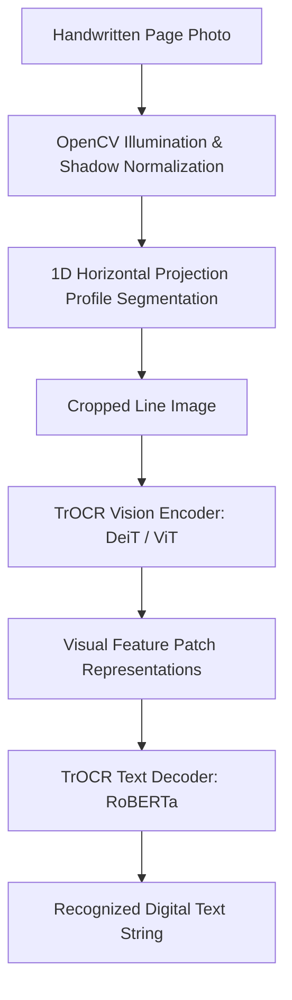

# Step 4 — Handwritten Text Recognition (HTR/OCR)

## 1. What is OCR & HTR?
**Optical Character Recognition (OCR)** refers to the automated conversion of images containing typed, printed, or handwritten text into machine-encoded digital text. 

When applied specifically to handwriting, it is commonly called **Handwritten Text Recognition (HTR)**. Unlike printed fonts with rigid, predictable geometric forms, handwriting introduces enormous variance in stroke width, baseline tilt, cursive connections, character spacing, slant, and ligature styles.

---

## 2. Why WriteAI Needs OCR
WriteAI is a personalized handwriting generation system. To learn, emulate, or synthesize a user's unique handwriting style, the system needs paired visual and semantic representations:
1. **Text Line Alignment**: Connecting what was written (digital ground truth tokens) with how it was written (line and character strokes).
2. **Sample Verification**: Ensuring uploaded sample pages contain sufficient textual variety and valid vocabulary.
3. **Automated Vocabulary & Style Indexing**: Mapping individual handwritten glyphs and words to digital ASCII/Unicode characters for downstream style encoding and synthesis.

---

## 3. Why Microsoft TrOCR?
Rather than training a custom CNN-RNN-CTC model from scratch or using traditional OCR engines tuned for printed typography (such as Tesseract), WriteAI adopts **Microsoft TrOCR** (`microsoft/trocr-base-handwritten`).

Key advantages:
* **End-to-End Transformer Architecture**: Replaces fragile heuristic feature extraction and CTC alignment with standard attention-based sequence-to-sequence modeling.
* **Pretrained on Massive Handwritten Datasets**: Pretrained on both synthetic text lines and large-scale historical/modern handwriting benchmarks (IAM, RIMES).
* **Native Line-Level Processing**: Recognizes complete lines of text in a single forward pass without requiring character-level segmentation.
* **Robust Language Prior**: The text decoder (RoBERTa) acts as a strong neural language model, resolving ambiguous handwritten letters using semantic context (e.g., distinguishing 'cl' from 'd' or 'rn' from 'm').

---

## 4. End-to-End System Pipeline

---

## 5. How TrOCR Works Conceptually

TrOCR employs an **Encoder-Decoder Transformer** architecture:
1. **Image Input**: The cropped line image is normalized and divided into small image patches (e.g. $16 \times 16$ pixels).
2. **Vision Encoder**: A Vision Transformer (DeiT/ViT) treats image patches analogously to text tokens, computing self-attention across visual features, stroke trajectories, and ascender/descender patterns.
3. **Cross-Attention & Text Decoder**: A language model decoder (RoBERTa) attends to the visual patch tokens via cross-attention layers.
4. **Autoregressive Generation**: The decoder predicts character tokens step-by-step until the sequence terminator is produced.

---

## 6. Why We Segment the Page into Lines First
* Vision Transformers expect rectangular line strips with consistent vertical height rather than giant, high-resolution 2D pages.
* Feeding a full page (e.g., $1280 \times 963$ pixels) directly to a transformer would cause quadratic memory explosion ($O(N^2)$ attention over thousands of patches) and confuse reading order.
* Line segmentation decomposes a complex 2D page into an ordered list of 1D line recognition tasks, matching human reading direction (top-to-bottom, left-to-right).

---

## 7. Why We Do Not Manually Segment Every Character
* In cursive and semi-cursive handwriting, letters frequently overlap, connect via ligatures, or share continuous ink strokes (e.g., "th", "ing", "oo").
* Classical bounding-box character segmentation frequently cuts characters in half or fails at ligature junctions.
* TrOCR's visual attention mechanism learns character boundaries implicitly, entirely eliminating the need for fragile character slicing.

---

## 8. CPU vs. GPU Inference
| Aspect | CPU Inference | GPU (CUDA) Acceleration |
| :--- | :--- | :--- |
| **Availability** | Works on any standard computer | Requires NVIDIA GPU + CUDA drivers |
| **Model Load Time** | ~5–10 seconds | ~3–5 seconds |
| **Speed per Line** | ~0.8 – 1.8 seconds / line | ~0.08 – 0.20 seconds / line |
| **Full Page (20 lines)**| ~20 – 35 seconds | ~2 – 4 seconds |
| **Resource Usage** | ~800 MB system RAM | ~1.2 GB VRAM |

The WriteAI backend automatically probes `torch.cuda.is_available()`:
* If an NVIDIA GPU is detected, CUDA tensors are utilized.
* If only a CPU is present, the model operates in float32 evaluation mode with multi-threading without requiring specialized drivers.

---

## 9. Known Limitations
1. **Camera Tilt & Skew**: Severe perspective distortion or angled photographs can tilt text lines relative to the horizontal patch grid.
2. **Bleed-Through Interference**: Heavy ink bleed-through from the back of thin paper can occasionally introduce spurious punctuation or characters.
3. **Special Symbols & Non-English Scripts**: The `microsoft/trocr-base-handwritten` checkpoint is optimized for Latin-script text and may substitute complex mathematical formulas, currency symbols, or non-Latin glyphs with approximate English characters.
4. **Messy / Unconventional Handwriting**: Extremely stylized or fragmented handwriting can cause occasional letter substitutions (e.g. "computers" recognized as "computers" or "conflicts" as "conflicts").
